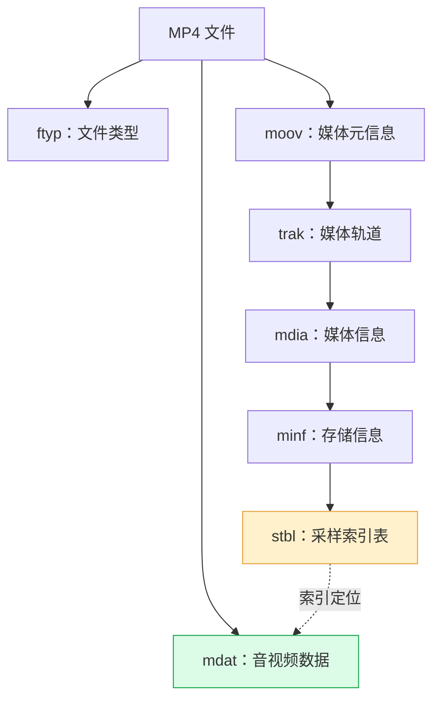
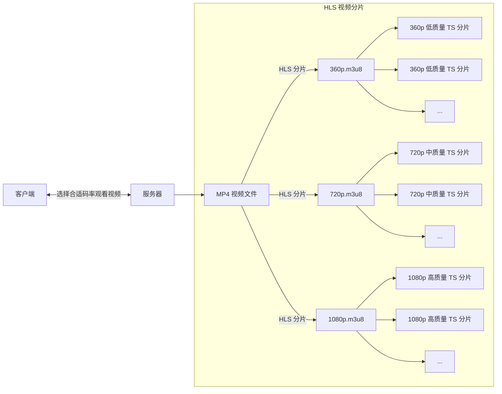

# FFmpeg使用

FFmpeg 是一个领先的开源项目，主要功能是处理音频、视频、字幕等多媒体流。它的核心是命令行工具 ffmpeg 、ffplay 和 ffprobe 。libffmpeg 并非指代一个单一库。 它是一个常用的统称，指的是 FFmpeg 项目构建并分发出来的那些功能强大的底层库集合。这些库提供了实现命令行工具功能的 API（应用程序编程接口）。

**核心组件库：**

- 最常见的被统称为 libffmpeg 的核心库包括：
  - **libavcodec**: 编解码器库。这是 FFmpeg 的核心和灵魂，提供了数百种音视频编解码器的实现（编码器和解码器）。它是处理多媒体文件内容（压缩/解压缩）的核心引擎。
  - **libavformat**: 封装/解封装库。用于读取（解封装）和写入（封装）各种媒体容器格式（如 MP4, MKV, AVI, MOV, FLV, MPEG-TS, WebM 等）。
  - **libavutil**: 通用工具库。包含许多辅助函数，用于基本数学操作、数据结构（链表、字典、队列）、内存管理、错误处理、日志记录、时间戳处理等。
  - **libswscale**: 图像缩放和像素格式转换库。用于在图像大小、色彩空间（如 RGB, YUV）和像素格式之间进行转换（缩放、色彩空间转换）。
  - **libavfilter**: 滤镜处理库。提供丰富的框架用于实现复杂的音视频滤镜链（如裁剪、缩放、旋转、叠加水印、模糊、降噪、调色、音频混音、变速等）。
  - **libavdevice**: 设备输入/输出库。用于访问和处理外部设备（如摄像头、麦克风、屏幕采集、DeckLink 设备等）的输入输出。
  - **libpostproc**: 后期处理库 (通常与 libavcodec 深度集成)。提供一些特定的后期处理滤镜，常用于旧式格式或特定编解码器产生的伪影处理（如去块效应）。
  - **libswresample**: 音频重采样库。用于进行高质量的音频重采样（改变采样率）、通道布局转换（如立体声转单声道）和样本格式转换（如 16-bit PCM 转 Float）。

**主要功能：**

- 多媒体解码：读取和解压几乎所有主流（以及大量小众）的音视频格式。
- 多媒体编码：将原始或处理过的音视频数据压缩编码成各种格式。
- 格式转换：将一个格式（包括编码和封装）的文件转换为另一种格式。
- 流媒体处理：支持直播流的输入（解封装、解码）、输出（编码、封装、推流）、转封装、协议处理（RTMP, RTSP, HLS, DASH, SRT 等）。
- 音视频过滤与编辑：实现复杂的图像处理、音频效果、剪辑（结合其他工具）、合成等。
- 设备捕获与播放：抓取摄像头、麦克风输入；在自定义界面播放音视频（需要结合GUI框架）。
- 媒体分析：提取媒体文件的元信息、流属性、帧信息等（主要由 libavformat 和 libavcodec 提供支持，是 ffprobe 的基础）。

## MP4视频

MP4（MPEG-4）是一种非常流行的数字多媒体容器格式，可以把视频、音频、字幕、图片等各种媒体数据和元数据打包在一起。由于其高效的压缩和广泛的兼容性，MP4已成为网络视频、移动设备和社交媒体分享的首选格式之一。

MP4文件由称为 Box（或称 Atom） 的基本单元组成。每个Box都包含一个Header和Data两部分。Header指明了Box的类型和大小，Data则承载实际内容或嵌套其他Box。

一个MP4文件可以看作是由这些Box组成的树状结构，其中，最顶层的Box有三个：

- ftyp (File Type Box)总是位于**文件开头**，用于标识文件类型。
- moov (Movie Box)和 mdat (Media Data Box)的顺序不固定：
  - **moov 在前mdat 在后**：更利于流媒体播放（Fast Start），无需下载完整文件即可开始播放。
  - mdat 在前moov 在后：**常见于实时录制的视频**，因为录制开始时无法预知媒体数据的最终大小和元信息
- stbl (Sample Table Box) 尤为关键，它像一个详细的索引目录，记录了媒体数据如何存储、如何解码以及时间信息如何映射，是播放器能够正确定位和播放媒体（尤其是随机拖拽）的核心。





## HLS 协议

是 Apple 提出的基于 HTTP 的流媒体传输协议。它已被业界广泛采纳，成为主要的流媒体传输方案之一（尤其是在点播、直播和时移回看领域）。

**工作流程：**

1. 编码与分片：原始视频被转码为多码率版本，并切割为 TS 分片（通常 2~10 秒）。
2. 生成 M3U8 播放列表：每个码率对应一个 M3U8 文件，主播放列表（Master Playlist）描述所有可用码率**（每一个分片的路径信息）。**
3. 客户端拉取：播放器根据网络状况选择合适码率，按顺序下载分片并播放。

**优点：**

- 基于 HTTP，兼容性强（无特殊服务器或端口要求）。
- 支持**自适应码率切换（ABR）**，提升弱网体验。
- 天然支持 CDN 和缓存。

**缺点：**

- 延迟较高（通常 10~30 秒），不适合实时交互场景。
- 分片和 M3U8 更新机制对服务器有一定压力。



**M3U8文件格式**

文件内容：

```m3u8
#EXTM3U
#EXT-X-VERSION:3
#EXT-X-PLAYLIST-TYPE:VOD
#EXT-X-TARGETDURATION:10
#EXT-X-MEDIA-SEQUENCE:0

#EXTINF:10.0,
http://192.168.65.130:9000/segment0.ts
#EXTINF:8.5,
segment1.ts
#EXTINF:9.2,
segment2.ts

#EXT-X-ENDLIST
```

**关键标签：**

| 标签 | 说明 |
| --- | --- |
| `#EXTM3U` | 文件头，标识 M3U8 格式 |
| `#EXT-X-VERSION` | 指定 HLS 协议版本（如 3、6、7） |
| `#EXT-X-PLAYLIST-TYPE` | 播放类型，VOD 表示当前视频为点播类型 |
| `#EXT-X-TARGETDURATION` | 所有分片的最大时长（单位：秒） |
| `#EXT-X-MEDIA-SEQUENCE` | 第一个分片的序列号（用于直播流滑动窗口） |
| `#EXTINF` | 分片时长和路径 |
| `#EXT-X-ENDLIST` | 标识点播流结束（直播流无此标签） |

## libffmpeg 实现视频分片

### FFmpeg 与 libffmpeg

- FFmpeg：开源音视频处理工具，支持编解码、转封装、流媒体处理等。
- libffmpeg：FFmpeg 的编程接口库，可直接集成到 C/C++ 项目中。

| 库名 | 功能 |
| --- | --- |
| libavcodec | 编解码核心库 |
| libavformat | 封装与解封装 |
| libavutil | 通用工具（如时间计算、日志） |
| libswscale | 图像缩放与色彩空间转换 |

### 安装

```bash
sudo apt install libavcodec-dev libavformat-dev libavutil-dev libswscale-dev
```

### 头文件

```cpp
#include <libavformat/avformat.h>
#include <libavcodec/avcodec.h>
#include <libavutil/opt.h>
#include <libavutil/error.h>
```

### 关键结构

```cpp
typedef struct AVFormatContext {
    struct AVInputFormat *iformat; //输入格式化对象
    struct AVOutputFormat *oformat; //输出格式化对象
    unsigned int nb_streams;     //媒体流的数量（如视频流、音频流、字幕流）
    AVStream **streams;        //指向所有流的指针数组，通过索引访问
    int64_t start_time;        //媒体文件的起始时间戳
    int64_t duration;          //媒体文件的总时长
    int64_t bit_rate;          //全局码率
    ....
};

struct AVStream {
    int id;               //流的唯一标识符
    int64_t start_time;        //流的起始时间戳
    int64_t duration;         //流的总时长
    int64_t nb_frames;         //流的总帧数
    AVRational time_base;      //时间基（时间戳单位），如 {1, 1000} 表示毫秒
    AVRational avg_frame_rate;   //平均帧率（如 {25, 1} 表示 25 FPS）
    AVRational r_frame_rate;    //标称帧率用于关键帧间隔计算。
    AVCodecParameters *codecpar;  //编解码参数（如编码格式、分辨率、采样率等）
    ...
}

struct AVCodecParameters {
    enum AVMediaType codec_type;//媒体类型：如 AVMEDIA_TYPE_VIDEO、 AVMEDIA_TYPE_AUDIO
    enum AVCodecID   codec_id;  //编解码器ID：如AV_CODEC_ID_H264、AV_CODEC_ID_AAC
    uint32_t         codec_tag; //格式特定的编解码标签
    int format;           //数据格式：视频/音频
    int64_t bit_rate;       //码率（单位：bps），若未知则为 0
    int width;           //视频分辨率（单位：像素）
    int height;
    ...
}

typedef struct AVPacket {
    int64_t pts;      //显示时间戳，单位：stream->time_base
    int64_t dts;      //解码时间戳，单位：stream->time_base
    int   size;      //数据包大小（字节数）
    int   stream_index; //所属流的索引
    int64_t duration;  //数据包持续时间
    int64_t pos;     //数据包在输入文件中的字节偏移量
    ...
}

typedef struct AVDictionaryEntry {
    char *key;
    char *value;
} AVDictionaryEntry
```

### 关键接口

#### 视频操作

```cpp
/* 功能：打开输入文件/流，初始化 AVFormatContext。
  参数：
    ps：指向 AVFormatContext 指针的指针，函数内部分配并填充该结构体。
    url：输入文件路径或 URL（如 "input.mp4"、"rtmp://example.com/live"）。
    fmt：强制指定输入格式（如 AVInputFormat），通常设为 NULL 自动探测。
    options：附加选项（如设置超时、协议参数），可为 NULL
  返回值：<0表示失败*/
int avformat_open_input(AVFormatContext **ps,
    const char *url,
    AVInputFormat *fmt,
    AVDictionary **options);
/* 功能：读取输入文件的流信息（如编码参数、帧率、时长）。
  参数：
    ic：已初始化的 AVFormatContext。
    options：流探测的附加选项（如限制探测时长），可为 NULL
  返回值：<0表示失败*/
int avformat_find_stream_info(AVFormatContext *ic, AVDictionary **options);
/* 功能：分配输出格式的上下文（AVFormatContext）。
  参数：
    ctx：输出 AVFormatContext 的双重指针。
    oformat：强制指定输出格式，设为 NULL 时由 format_name 或 filename 推断。
     format_name：输出格式短名称（如 "mp4"、"hls"）。
     filename：输出文件名或 URL，用于辅助推断格式。 对于hls输出文件名: xx.m3u8
  返回值：<0表示失败*/
int avformat_alloc_output_context2(
    AVFormatContext **ctx,
    AVOutputFormat *oformat,
    const char *format_name,
    const char *filename);
/* 功能：释放由 avformat_alloc_output_context2 分配的 AVFormatContext。
  参数：
   s：待释放的 AVFormatContext 指针。*/
void avformat_free_context(AVFormatContext *s);
/* 功能：关闭输入文件并释放 AVFormatContext 相关资源。
  参数：
   s：指向 AVFormatContext 指针的指针，调用后指针会被置为 NULL*/
void avformat_close_input(AVFormatContext **s);
/* 功能：为输出上下文创建新的流。
  参数：
   s：输出格式的 AVFormatContext。
   c：流的编解码器（可为 NULL，后续手动设置编码参数）。
  返回值：NULL-失败*/
AVStream *avformat_new_stream(AVFormatContext *s, const AVCodec *c);
/* 功能：复制编解码参数（从输入流到输出流）。
  参数：
    dst：目标流的 AVCodecParameters。
    src：源流的 AVCodecParameters
  返回值：<0表示失败*/
int avcodec_parameters_copy(AVCodecParameters *dst, const AVCodecParameters *src);
/* 功能：写入输出文件的头部信息。
  参数：
   s：输出的 AVFormatContext。
       options: 配置字典选项，根据字典选项决定写入头部内容*/
int avformat_write_header(AVFormatContext *s, AVDictionary **options);
  // 返回值：<0表示失败
/* 功能：从输入文件中读取一个数据包（AVPacket）。
  参数：
   s：输入的 AVFormatContext。
    pkt：指向 AVPacket 的指针，用于存储读取的数据
 返回值：<0表示失败或读取结束*/
int av_read_frame(AVFormatContext *s, AVPacket *pkt);
/* 功能：释放 AVPacket 中的资源（如数据缓冲区）。
  参数：
    pkt：待释放的 AVPacket。
 注意：每次调用 av_read_frame 后必须调用此函数，避免内存泄漏*/
void av_packet_unref(AVPacket *pkt);
/* 功能：将数据包按时间戳顺序写入输出文件（自动处理交织）。
  参数：
   s：输出的 AVFormatContext。
    pkt：待写入的 AVPacket。
  返回值：<0表示失败*/
int av_interleaved_write_frame(AVFormatContext *s, AVPacket *pkt);
/* 功能：写入输出文件的尾部信息（如 MP4 的 moov 原子）。
  参数：
   s：输出的 AVFormatContext。*/
int av_write_trailer(AVFormatContext *s);

/*
 功能：获取每个接口执行失败的原因，也就是前边各个接口的返回值
*/
int av_strerror(int errnum, char *errbuf, size_t errbuf_size);
```

#### 时间基转换

```cpp
/* 功能：将时间戳从一个时间基转换到另一个时间基。
  公式： result=a×bq/cq
  参数：
    a：原始时间戳。
    bq：原时间基。
    cq：目标时间基。
 返回值：转换后的时间戳
*/
int64_t av_rescale_q(int64_t a, AVRational bq, AVRational cq)
/* 功能：批量转换数据包的 pts、dts 和 duration 到新时间基。
  参数：
    pkt：待处理的 AVPacket。
     tb_src：原时间基。
     tb_dst：目标时间基。
*/
void av_packet_rescale_ts(AVPacket *pkt, AVRational tb_src, AVRational tb_dst);

/*
   AV_TIME_BASE 是 FFmpeg 内部使用的时间基准（Time Base）常量，定义在 libavutil 库中。
 它代表了 FFmpeg 内部计算时间和持续时间时使用的基本时间单位

  在视频处理（特别是在FFmpeg等多媒体框架中），时间基准（Time Base）是最核心的底层时间度量单位，
 其作用是定义时间戳（PTS/DTS）和持续时间的数值如何映射到真实时间。
*/
AVRational AV_TIME_BASE_Q = {1, AV_TIME_BASE};
```

#### 字典选项：

```cpp
/* 功能：设置字典选项
 参数：
    pm：字典对象指针，若为*pm为NULL，则会申请空间并添加字典数据
     key：字典字段key
     value：为key字段要设置的数据
      flags： 默认为0，函数内部会自动复制键名（key）和转换后的值字符串，调用者无需管理内存
*/
int av_dict_set_int(AVDictionary **pm, const char *key, int64_t value, int flags);
int av_dict_set(AVDictionary **pm, const char *key, const char *value, int flags);
/* 释放字典对象资源
*/
void av_dict_free(AVDictionary **m);
```

HLS分片相关的字典选项：

| 选项 | 功能 |
| --- | --- |
| `hls_time` | 指定每个 TS 分片的时长（单位：秒） |
| `hls_base_url` | 设置 M3U8 文件中分片 URL 的基础路径 |
| `hls_list_size` | 控制播放列表中保留的分片数量，0表示不做限制 |
| `hls_playlist_type` | 定义播放列表类型，影响 M3U8 结构。<br>• vod ：点播模式，添加 EXT-X-ENDLIST ，列表不再更新。<br>• event ：事件流，列表持续更新但不删除旧分片 |
| `hls_flags` | 通过标志位启用高级功能（多选时用 + 分隔）<br>• split_by_time ：强制按 hls_time 分片，忽略关键帧间隔。<br>• independent_segments ：标记分片可独立解码，提升兼容性。<br>• delete_segments ：自动删除已被播放列表移除的旧分片(直播节省空间)<br>• append_list ：在已有 M3U8 文件末尾追加新分片（重启时不覆盖） |
| `hls_segment_filename` | 自定义分片文件名格式（支持 %d 占位符），例如：“segment_%03d.ts” |
| `hls_key_info_file` | 指定加密分片的密钥信息文件路径（启用 AES-128 加密） |
| `hls_allow_cache` | 控制客户端是否缓存分片（通过 EXT-X-ALLOW-CACHE 标签）<br>• 1 （允许缓存）或 0 （禁用缓存） |
| `hls_init_time` | 设置初始分片的时长（首个分片可能较短，用于快速起播） |
| `hls_ts_options` | 传递额外参数给 TS 分片编码器（如设置视频参数） |

点播示例：

```cpp
av_dict_set(&options, "hls_time", "10", 0);
av_dict_set(&options, "hls_list_size", "0", 0);
av_dict_set(&options, "hls_playlist_type", "vod", 0);
av_dict_set(&options, "hls_flags", "independent_segments", 0);
av_dict_set(&options, "hls_segment_filename", "vod_segment_%03d.ts", 0);
av_dict_set(&options, "hls_base_url", "http://example.com/", 0);
```

**使用样例**

流程：

1. 打开输入文件，并初始化输入格式化对象
2. 查找输入视频参数
3. 申请输出格式化对象
4. 遍历输入媒体流
   - a. 为输出对象申请媒体流
   - b. 从输入媒体流复制解码器参数到输出媒体流中
5. 设置分片字典选项
6. 通过输出格式化对象，输出媒体头部信息
7. 遍历输入流中的数据帧
   - a. 将数据包中的时间戳，从输入流的时间基转换为输出流的时间基的时间戳
     - i. 若数据帧的显示时间戳无效(AV_NOPTS_VALUE)，则默认为从0开始的默认时间基
     - ii. 将从0开始的默认时间基转换为输入流时间基，重新进行a操作
   - b. 将数据帧写入输出格式化对象中
   - c. 释放帧结构资源
8. 通过输出格式化对象，输出媒体尾部信息
9. 释放资源：字典选项，输入格式化对象，输出格式化对象

## 封装

设计

在视频转码这里，目前我们的需求有两个：

1. 针对视频文件进行转码，生成转码后的视频文件
2. 解析生成M3U8文件内容，获取内容结构，并能够生成新的M3U8文件

针对这两个需求，我们封装两个类即可：

#### M3U8信息类

##### 成员变量

- M3U8文件名称
- 头部字段列表（有序）
- 分片信息列表（有序）

##### 成员方法

- M3U8文件解析
- M3U8文件生成
- 获取分片信息列表
- 获取头部字段列表

#### 7.1.2 HLS转码类

##### 7.1.2.1 成员变量

- HLS分片参数对象

##### 7.1.2.2 成员方法

- 视频文件转码
