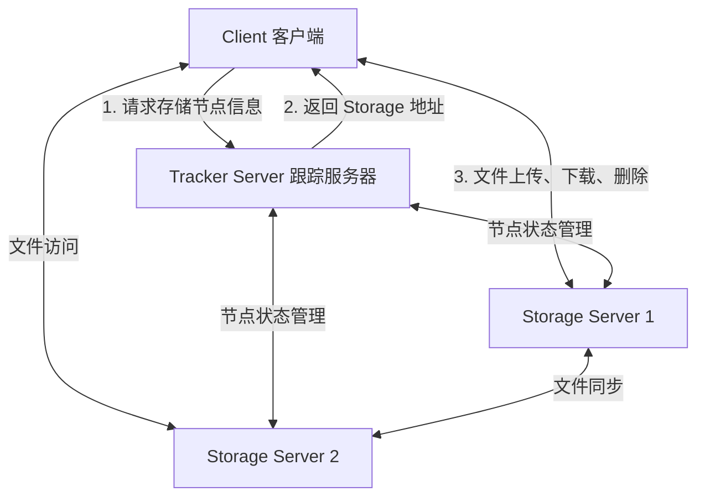

# FastDFS使用

FastDFS是一款开源的分布式文件系统，功能主要包括：文件存储、文件同步、文件访问（文件上传、文件下载）等，解决了文件大容量存储和高性能访问的问题。FastDFS特别适合以文件为载体的在线服务，如图片、视频、文档等等服务。

FastDFS作为一款轻量级分布式文件系统，版本V6.01代码量6.3万行。FastDFS用C语言实现，支持Linux、FreeBSD、MacOS等类UNIX系统。FastDFS类似google FS，属于应用级文件系统，不是通用的文件系统，只能通过专有API访问，目前提供了C客户端和Java SDK，以及PHP扩展SDK。

FastDFS为互联网应用量身定做，解决大容量文件存储问题，实现高性能和高扩展性。FastDFS可以看做是基于文件的key value存储系统，key为文件ID，value为文件本身，因此称作分布式文件存储服务更为合适。

FastDFS的架构比较简单，如下图所示：



### FastDFS特点：

1. 分组存储，简单灵活；
2. 对等结构，不存在单点；
3. 文件ID由FastDFS生成，作为文件访问凭证。不需要传统的name server或meta server；
4. 大、中、小文件均可以很好支持，可以存储海量小文件；
5. 一台storage支持多块磁盘，支持单盘数据恢复；
6. 提供了nginx扩展模块，可以和nginx无缝衔接；
7. 支持多线程方式上传和下载文件，支持断点续传；
8. 存储服务器上可以保存文件附加属性。

### SDK安装

```bash
git clone https://github.com/happyfish100/libfastcommon.git --depth 1
cd libfastcommon/ && ./make.sh && sudo ./make.sh install
cd ..
git clone https://github.com/happyfish100/libserverframe.git --depth 1
cd libserverframe/ && ./make.sh && sudo ./make.sh install
cd ..
git clone https://github.com/happyfish100/fastdfs.git --depth 1
cd fastdfs/ && ./make.sh && sudo ./make.sh install #编译安装#配置文件准备
sudo cp conf/http.conf /etc/fdfs/ #供nginx访问使用
sudo cp conf/mime.types /etc/fdfs/
```

## 接口

### 头文件

```cpp
#include <fastcommon/logger.h>
#include <fastdfs/fdfs_client.h>
```

### 链接库：

```text
-lfdfsclient -lfastcommon
```

### Log

fastdfs有自己的日志输出模块，让fastdfs只输出错误日志，避免因为大量的第三方库日志输出影响视线

```cpp
typedef struct log_context {
   //log level value please see: sys/syslog.h
   //default value is LOG_INFO
    int log_level;
    int log_fd;
   //.....
}
extern LogContext g_log_context;

/*
  初始化全局日志上下文，return: 0 for success, != 0 fail
*/
int log_init();

/*
   忽略SIGPIPE信号，return: error no , 0 success, != 0 fail
*/
int ignore_signal_pipe();
```

### Error

用于获取fastdfs接口调用失败的错误原因接口。

```cpp
#define STRERROR(no) (strerror(no) != NULL ? strerror(no) : "Unkown error")
```

### Init

初始化客户端全局配置，默认可以通过配置文件进行初始化，其实也可以将配置信息整到内存中，通过内存数据进行客户端全局配置初始化。

```ini
connect_timeout = 5
network_timeout = 60
tracker_server = 192.168.0.196:22122
use_connection_pool = false
connection_pool_max_idle_time = 3600
```

```cpp
#define fdfs_client_init(filename) \
        fdfs_client_init_ex((&g_tracker_group), filename)
//从配置文件初始化配置,
//return: 0 success, !=0 fail, return the error code
int fdfs_client_init_ex(TrackerServerGroup *pTrackerGroup, const char *conf_filename);

//根据给定内存数据初始化客户端配置
//return: 0 success, !=0 fail, return the error code
#define fdfs_client_init_from_buffer(buffer) \
        fdfs_client_init_from_buffer_ex((&g_tracker_group), buffer)
int fdfs_client_init_from_buffer_ex(TrackerServerGroup *pTrackerGroup, \
                const char *buffer);

#define fdfs_client_destroy() \
        fdfs_client_destroy_ex((&g_tracker_group))
void fdfs_client_destroy_ex(TrackerServerGroup *pTrackerGroup);
```

### Tracker

获取Tracker句柄，用于访问tracker服务器。

```cpp
typedef struct {
    int sock;
    uint16_t port;
    short af;  //address family, AF_INET, AF_INET6 or AF_UNSPEC for auto dedect
    FCCommunicationType comm_type;
    bool validate_flag;   //for connection pool
    char ip_addr[IP_ADDRESS_SIZE];
    void *arg1;    //for RDMA
    char args[0];   //for extra data
} ConnectionInfo;

#define tracker_get_connection() \
        tracker_get_connection_ex((&g_tracker_group))
ConnectionInfo *tracker_get_connection_ex(TrackerServerGroup *pTrackerGroup);

#define tracker_close_connection(pTrackerServer) \
        tracker_close_connection_ex(pTrackerServer, false)
//关闭所有Tracker连接，bForceClose表示是否强制关闭
void tracker_close_connection_ex(ConnectionInfo *conn, const bool bForceClose);
```

### Storage

从Tracker服务器上获取Storage信息，并返回storage节点操作句柄。

```cpp
#define FDFS_GROUP_NAME_MAX_LEN            16

#define tracker_query_storage_store(pTrackerServer, pStorageServer, \
                group_name, store_path_index) \
         tracker_query_storage_store_without_group(pTrackerServer, \
                pStorageServer, group_name, store_path_index)
//return: 0 success, !=0 fail, return the error code
int tracker_query_storage_store_without_group(ConnectionInfo *pTrackerServer,
                ConnectionInfo *pStorageServer, char *group_name,
                int *store_path_index);
```

### Upload

文件上传相关接口

```cpp
#define storage_upload_by_filename1(pTrackerServer, pStorageServer, \
                store_path_index, local_filename, file_ext_name, \
                meta_list, meta_count, group_name, file_id) \
        storage_upload_by_filename1_ex(pTrackerServer, pStorageServer, \
                store_path_index, STORAGE_PROTO_CMD_UPLOAD_FILE, \
                local_filename, file_ext_name, meta_list, meta_count, \
                group_name, file_id)
/*
 上传文件：
       pTrackerServer: tracker server连接句柄
       pStorageServer: storage server连接句柄，可以为NULL
       store_path_index: 获取storage节点时顺便获取的索引, 若没有主动获取节点则可以为0
       local_filename: 本地要上传的文件路径名
       file_ext_name: 文件扩展名，可以为null
       meta_list: 文件元信息数组
       meta_count: 元信息元素数量，若没有传递元信息数组则设置为0
       group_name: 若没有主动获取storage节点，则可以设置为null
       file_id: 输出参数--是文件上传保存成功后分配的标识ID
  return: 0 success, !=0 fail, return the error code
*/
int storage_upload_by_filename1_ex(ConnectionInfo *pTrackerServer, \
                ConnectionInfo *pStorageServer, const int store_path_index, \
                const char cmd, const char *local_filename, \
                const char *file_ext_name, const FDFSMetaData *meta_list, \
                const int meta_count, const char *group_name, char *file_id);

#define storage_upload_by_filebuff1(pTrackerServer, pStorageServer, \
                store_path_index, file_buff, file_size, file_ext_name, \
                meta_list, meta_count, group_name, file_id) \
        storage_do_upload_file1(pTrackerServer, pStorageServer, \
                store_path_index, STORAGE_PROTO_CMD_UPLOAD_FILE, \
                FDFS_UPLOAD_BY_BUFF, file_buff, NULL, \
                file_size, file_ext_name, meta_list, meta_count, \
                group_name, file_id)
int storage_do_upload_file1(ConnectionInfo *pTrackerServer, \
        ConnectionInfo *pStorageServer, const int store_path_index, \
        const char cmd, const int upload_type, \
        const char *file_buff, void *arg, const int64_t file_size, \
        const char *file_ext_name, const FDFSMetaData *meta_list, \
        const int meta_count, const char *group_name, char *file_id);

//文件元信息配置结构
typedef struct
{
        char name[FDFS_MAX_META_NAME_LEN + 1];  //key
        char value[FDFS_MAX_META_VALUE_LEN + 1]; //value
} FDFSMetaData;
//获取文件元信息
int storage_get_metadata1(ConnectionInfo *pTrackerServer, \
    ConnectionInfo *pStorageServer,  \
    const char *file_id, \
    FDFSMetaData **meta_list, int *meta_count);
```

### Download

文件下载相关接口

```cpp
#define storage_download_file1(pTrackerServer, pStorageServer, file_id, \
                        file_buff, file_size)  \
        storage_do_download_file1_ex(pTrackerServer, pStorageServer, \
                        FDFS_DOWNLOAD_TO_BUFF, file_id, 0, 0, \
                        file_buff, NULL, file_size)

#define storage_download_file_to_buff1(pTrackerServer, pStorageServer, \
                        file_id, file_buff, file_size)  \
        storage_do_download_file1_ex(pTrackerServer, pStorageServer, \
                        FDFS_DOWNLOAD_TO_BUFF, file_id, 0, 0, \
                        file_buff, NULL, file_size)
/**
* 从Storage下载文件
* params:
*      pTrackerServer: tracker server
*      pStorageServer: storage server
       download_type: FDFS_DOWNLOAD_TO_BUFF or FDFS_DOWNLOAD_TO_FILE
*      file_id: the file id (including group name and filename)
*      file_offset: the start offset to download
*      download_bytes: download bytes, 0 means from start offset to the file end
*      file_buff: return file content/buff, must be freed.or local filename
*      file_size: return file size (bytes)
* return: 0 success, !=0 fail, return the error code
**/
int storage_do_download_file1_ex(ConnectionInfo *pTrackerServer, \
                ConnectionInfo *pStorageServer, \
                const int download_type, const char *file_id, \
                const int64_t file_offset, const int64_t download_bytes, \
                char **file_buff, void *arg, int64_t *file_size);

/**
* download file from storage server
* params:
*      pTrackerServer: tracker server连接句柄
*      pStorageServer: storage server连接句柄，可以为NULL
*      file_id: 文件上传时返回的ID
*      local_filename: 要另存为的文件路径名
*      file_size: 输出参数，用于返回文件大小（必须获取）
* return: 0 success, !=0 fail, return the error code
**/
int storage_download_file_to_file1(ConnectionInfo *pTrackerServer, \
                ConnectionInfo *pStorageServer, \
                const char *file_id, \
                const char *local_filename, int64_t *file_size);
```

### Delete

文件删除接口

```cpp
//return: 0 success, !=0 fail, return the error code
int storage_delete_file1(ConnectionInfo *pTrackerServer, \
                        ConnectionInfo *pStorageServer, \
                        const char *file_id);
```

## 封装

根据提供的API接口封装一个FDFS客户端类，将初始化和请求过程封装起来，向外提供文件上传，下载，删除的接口即可（上传和下载接口都需要提供两种，基于缓冲区和文件的操作，因为网络通信中很多时候都是针对收到的数据进行操作，完全没必要把数据先存文件再上传）。
除此之外，为了便于初始化客户端，因此定义一个客户端配置信息结构体，只需要包含一些关键配置信息即可。

#### FDFS配置结构：

##### 成员变量

- tracker服务器地址
- 网络超时时间
- 连接超时时间
- 是否使用连接池（默认为是，关闭连接池在线程并发场景下会导致使用同一个connectid，存在线程安全问题）
- 连接池连接空闲超时时间

#### FDFS客户端类：

##### 成员方法

- 构造函数：完成初始化配置过程
- 从文件上传
- 从缓冲区上传
- 下载到文件
- 下载到缓冲区
- 删除文件
